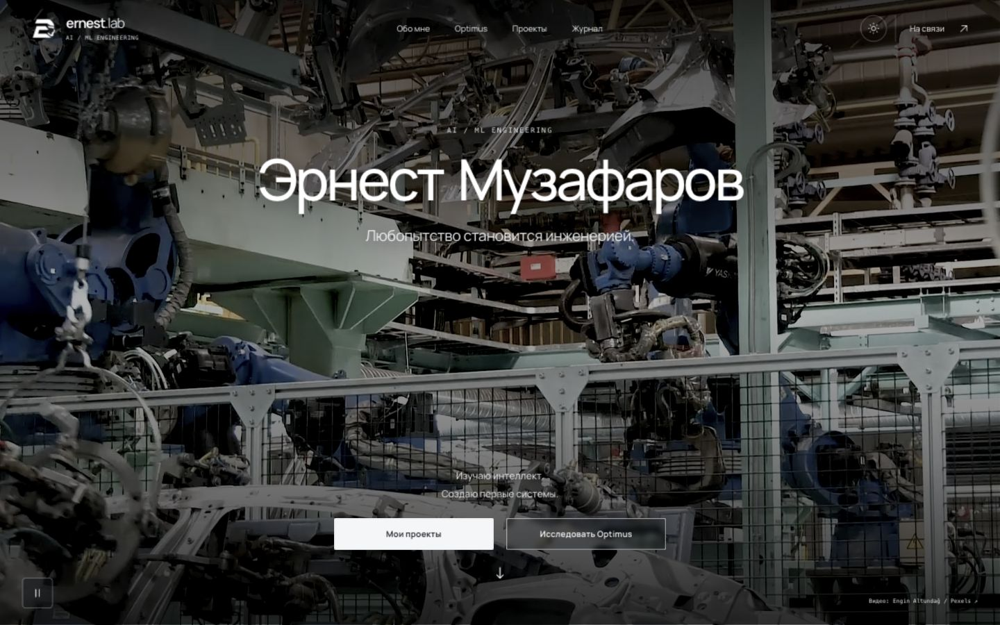

# Ernest Lab

Личное портфолио Эрнеста Музафарова об AI, машинном обучении и робототехнике.

[Сайт — ernestmuzafarov.tech](https://ernestmuzafarov.tech) · [GitHub](https://github.com/MrSSStrange) · [Telegram](https://t.me/ErnestKzn)



## Что внутри

- Видеопервый экран по композиционному референсу Tesla Careers: видео на весь экран, прозрачная навигация, имя и короткая подпись. Автозапуск без звука, пауза, остановка вне кадра.
- Настоящий лицензированный 3D-ассет Optimus в отдельной интерактивной сцене: плавное слежение за курсором, инерция, студийный свет и камера, связанная с прокруткой.
- Собственные фото и логотип Эрнеста, светлая и тёмная темы с сохранением выбора.
- Два действующих учебных проекта с реальными скриншотами, демо и кодом: [SupportDesk](https://github.com/MrSSStrange/ernest-supportdesk) и [расписание приёмов](https://github.com/MrSSStrange/clinic-appointments-dashboard). Они используют тестовые данные, клиентскую логику и localStorage.
- Три статьи с отдельными адресами, оглавлением, источниками и интерактивными объяснениями. История Optimus содержит закреплённый плеер и переключение глав.
- Адаптивная композиция, клавиатурное управление, `prefers-reduced-motion`, статичный постер без WebGL и ручной запуск видео при блокировке autoplay.

## Запуск

Node.js 22.12+; проверено на Node.js 24.

```sh
git clone https://github.com/MrSSStrange/ernest-portfolio.git
cd ernest-portfolio
npm ci
npm run dev
```

```sh
npm test          # геометрия ассета, ограничения и инерция движения
npm run build    # TypeScript, Vite, статические страницы и проверка релиза
npm run preview  # production-сборка локально
```

Стек: React 19, TypeScript, Vite, Three.js. Серверная часть для портфолио не требуется.

## Где редактировать

- `src/data.ts` — имя, описание, фото, логотип, контакты, проекты, статьи и источники.
- `src/FilmHero.tsx`, `src/film-hero.css` — видеопервый экран.
- `src/Hero.tsx`, `src/scene.ts` — интерактивная сцена Optimus.
- `src/Home.tsx`, `src/shell.tsx` — разделы, навигация и футер.
- `src/Video.tsx` — содержательные видео YouTube и управление видимостью.
- `src/style.css`, `src/details.css` — единые токены тем, сетка и страницы чтения.
- `design-system/ernest-lab/MASTER.md` — дизайн-система и конкретные референсы.

GitHub, Telegram и LinkedIn перенесены из предыдущего опубликованного портфолио. Email пока пуст и скрыт. Опыт, профессиональные достижения и метрики без подтверждения не добавляются.

## Материалы

**Optimus:** [Tesla optimus](https://sketchfab.com/3d-models/tesla-optimus-2fab5d31927f43729a99a6e8eaf1c7f5) — Mechamaner.V, [CC BY 4.0](https://creativecommons.org/licenses/by/4.0/). Независимая авторская модель; точное соответствие официальному Gen 3 не заявляется. Процедурного робота в сцене нет.

Активный файл `public/models/optimus-head-smooth-v2.glb`: 1 759 760 байт, 122 508 треугольников, три материала. Все исходные контрольные точки и размеры сохранены, поверхность между ними сглажена, meshopt-декодирование проверено. Исходный выделенный экспорт сохранён отдельно. Автор, лицензия и изменения указаны в интерфейсе, GLB и `public/models/ATTRIBUTION.txt`.

**Фоновый фильм:** [Automated Car Factory](https://www.pexels.com/video/automated-car-factory-6450803/) — Engin Altundağ, [Pexels License](https://www.pexels.com/license/). Локальный MP4 1920 × 1080, около 8,4 секунды, 5,23 MB. Видео — визуальная тема робототехники, оно не показывает проекты Эрнеста и не обозначается как материал Tesla. Источник, SHA-256 и лицензия сохранены в `docs/film-source.json`.

**Другие видео:** официальные ролики Tesla встроены через YouTube IFrame API; файлы роликов Tesla не переиздаются.

**Дизайн:** UI UX Pro Max и референсы 21st.dev; для нового первого экрана — [Tesla Careers](https://www.tesla.com/careers). **Шрифт:** Manrope, Mikhail Sharanda, SIL Open Font License.

Полная атрибуция доступна на `/credits/`; технические отчёты и контрольные снимки находятся в `docs/`.

## Публикация

Исходники находятся в `main`, готовый статический релиз — в `gh-pages`. Домен `ernestmuzafarov.tech`, CNAME и HTTPS сохраняются.

После коммита исходников:

```sh
git push origin main
npm run deploy:github
```

Команда проверяет рабочее дерево, запускает тесты и сборку, затем обычным push обновляет ветку `gh-pages`. GitHub Pages публикует её корень. Потребуются Git и настроенная авторизация GitHub. Force-push не используется.

Предыдущий сайт сохранён в истории и резервной ветке `backup/pre-ai-lab-2026-11-01`. Для возврата можно восстановить его дерево новым коммитом, сохранив историю.
