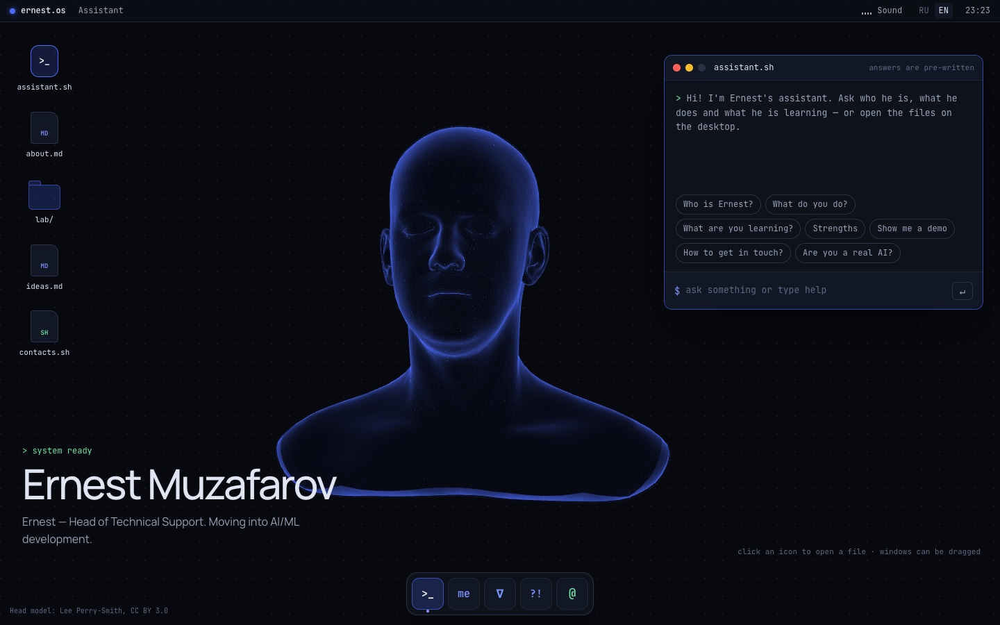

<h1 align="center">ernest.os — portfolio</h1>

<p align="center">
  A personal portfolio built as a tiny operating system: a desktop with files and windows,<br />
  an AI assistant you can talk to and a holographic 3D head on the wallpaper.
</p>

<p align="center">
  <a href="https://ernestmuzafarov.tech"></a>
  
  
  
</p>

<p align="center">
  <a href="https://ernestmuzafarov.tech"></a>
</p>

<p align="center">
  <a href="#english">English</a> · <a href="#русский">Русский</a>
</p>

---

## English

### How it works

- **Boot screen.** A short system log, skippable with a click.
- **Desktop.** Files on the left (`assistant.sh`, `about.md`, `lab/`, `ideas.md`, `contacts.sh`), a dock at the bottom and a top bar with RU / EN, sound and a clock.
- **Windows.** Open from an icon or the dock, drag by the title bar, close with the red button or Esc. On phones they open full screen, like apps.
- **Assistant.** Opens right after boot. Pick a suggested question or type your own: it matches keywords, types out the answer and opens the matching window. The answers are pre-written from the site's own texts, and the assistant says so when asked whether it is a real AI.
- **Holographic head.** A dark silhouette with a glowing blue rim, a wireframe mesh, a scan line running top to bottom and signals flying through the mesh. It follows the cursor and "talks" while the assistant is typing: the scan and the signals speed up.

### Windows

| File | What is inside |
| --- | --- |
| `assistant.sh` | Chat with the assistant |
| `about.md` | About, strengths and learning progress drawn as terminal bars |
| `~/lab` | Three demos computed in the browser: a neuron and a hidden-layer network learning with gradient descent, gradient descent on a loss surface, next-token sampling with temperature |
| `ideas.md` | Problems I want to learn to solve with AI — directions to explore, not finished projects |
| `contacts.sh` | Telegram, GitHub, LinkedIn |

### Tech stack

| Part | Technology |
| --- | --- |
| Markup and styles | HTML, CSS |
| 3D head | three.js r128, custom GLSL shaders, GLTFLoader |
| Window manager, assistant, demos | Plain JavaScript, Canvas 2D |
| Sound | Web Audio API, synthesised, off by default |
| Hosting | GitHub Pages with a custom domain |

### Project structure

```text
index.html                 desktop, windows and dock; texts come from data-i18n keys
style.css                  styles
script.js                  settings and texts at the top, then all the code
assets/models/head.glb     3D head model
assets/vendor/             GLTFLoader from the three.js r128 examples
docs/                      README images
CNAME                      custom domain for GitHub Pages
```

### Editing content

Everything you are likely to change sits at the top of `script.js`:

- `CONTACTS` — Telegram, GitHub, LinkedIn;
- `LEARNING` — learning progress. Each step has `status: 'done' | 'current' | 'todo'`; the bars and the assistant's "What are you learning?" answer update from it;
- `I18N` — all texts in Russian and English, including the boot log (`os`) and the assistant's questions and answers (`assistant`).

Keywords for free-text questions are in `KEYWORDS` right after the settings.

### Credits

- Head model: Lee Perry-Smith, licensed under [CC BY 3.0](https://creativecommons.org/licenses/by/3.0/), taken from the [three.js examples](https://threejs.org/examples/#webgl_decals).
- [three.js](https://threejs.org/) and its GLTFLoader, MIT license.

---

## Русский

Сайт-портфолио в виде маленькой операционной системы.

**Что на сайте:**

- **Загрузка системы**, её можно пропустить кликом.
- **Рабочий стол:** файлы `assistant.sh`, `about.md`, `lab/`, `ideas.md`, `contacts.sh`, док и верхняя панель с RU / EN, звуком и часами.
- **Окна** открываются из иконок и дока, их можно таскать и закрывать (кнопкой или Esc). На телефоне окна открываются на весь экран.
- **ИИ-ассистент** открыт сразу после загрузки. Он отвечает на готовые вопросы и на свободный текст по ключевым словам и сам открывает нужное окно. Ответы написаны заранее из текстов сайта, и на вопрос «Ты настоящий ИИ?» ассистент честно об этом говорит.
- **Голова-голограмма на обоях:** светящаяся сетка, линия сканирования и сигналы. Она следит за курсором и «говорит», пока ассистент печатает ответ.
- **Лаборатория** с тремя демками, всё считается в браузере.

**Где менять:** всё в начале `script.js`:

- `CONTACTS` — контакты;
- `LEARNING` — прогресс обучения;
- `I18N` — тексты на двух языках, включая загрузку и ответы ассистента.

**Хостинг:** GitHub Pages, домен [ernestmuzafarov.tech](https://ernestmuzafarov.tech).

**Модель головы:** Lee Perry-Smith, CC BY 3.0, из примеров three.js.

---

<p align="center">
  <a href="https://ernestmuzafarov.tech">ernestmuzafarov.tech</a> ·
  <a href="https://t.me/ErnestKzn">Telegram</a> ·
  <a href="https://www.linkedin.com/in/ernest-muzafarov-919a323a2/">LinkedIn</a> ·
  <a href="https://github.com/MrSSStrange">GitHub</a>
</p>
